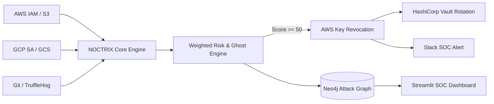
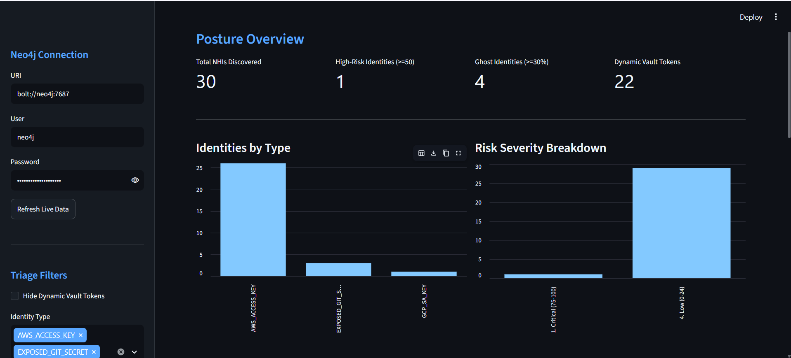
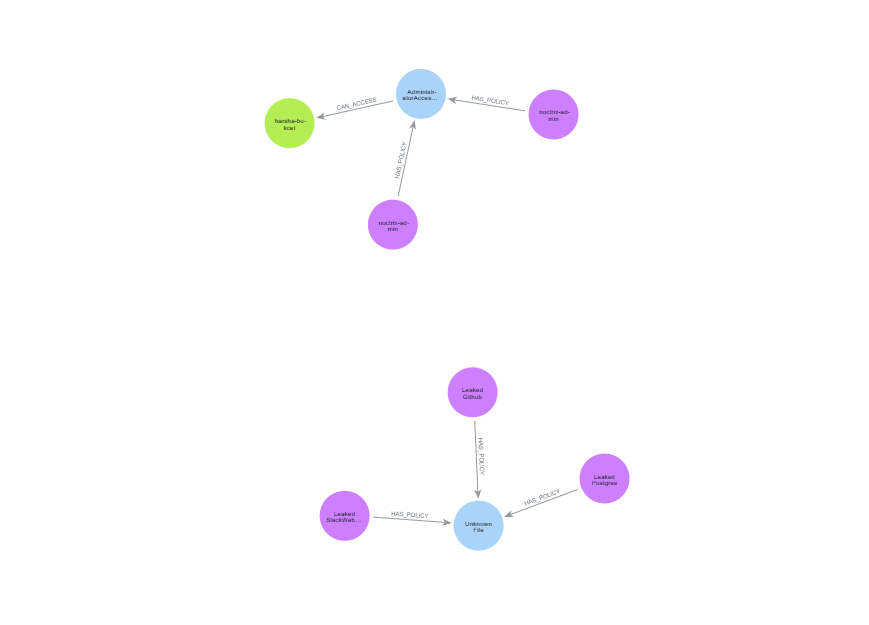

# NOCTRIX — Non-Human Identity (NHI) Security Posture & Remediation Framework

NOCTRIX discovers, scores, maps, and automatically remediates high-risk Non-Human Identities (AWS IAM keys, GCP Service Account keys, and leaked Git secrets) across multi-cloud environments.

## Architecture

## Core Capabilities
- **Multi-Cloud Discovery:** Scans live AWS IAM keys/S3 buckets, GCP user-managed Service Account keys/GCS buckets, and Git repositories via TruffleHog.
- **Weighted Risk & Ghost-Confidence Scoring:** Differentiates ephemeral Vault tokens from static admin keys, leaked Git secrets, and orphaned accounts.
- **Automated Remediation & Rotation:** Disables compromised AWS keys, generates dynamic short-lived credentials via HashiCorp Vault, and sends real-time Slack alerts.
- **Graph-Based Blast Radius:** Maps `Identity -> Policy -> Resource` attack paths in Neo4j with an interactive `pyvis` visualization in Streamlit.

## Tech Stack
- **Language:** Python 3.12, Pydantic
- **Cloud & Secrets:** AWS Boto3, GCP IAM/Storage, TruffleHog, HashiCorp Vault
- **Graph & Visualization:** Neo4j, Streamlit, PyVis
- **Infrastructure:** Docker, Docker Compose

## Quick Start
1. Clone the repository and configure credentials: `cp .env.example .env`
2. Launch the full stack: `docker compose up -d --build`
3. Run a live scan: `python main.py`
4. Open the SOC Dashboard at `http://localhost:8501`

## Documentation
- [L1 SOC Triage & Remediation Runbook](docs/SOC_RUNBOOK.md)

## Dashboard & Attack Path Visuals

### SOC Security Posture Dashboard (Streamlit)

### Multi-Cloud Attack Path Mapping (Neo4j)

